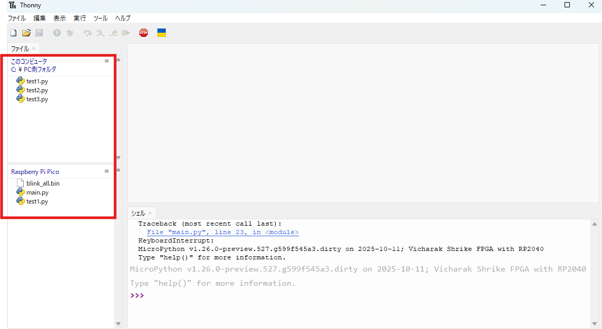
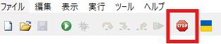
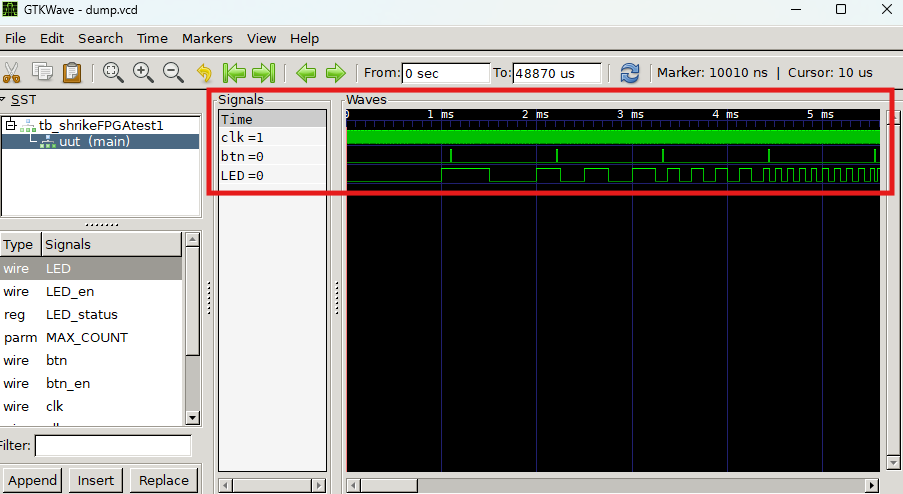
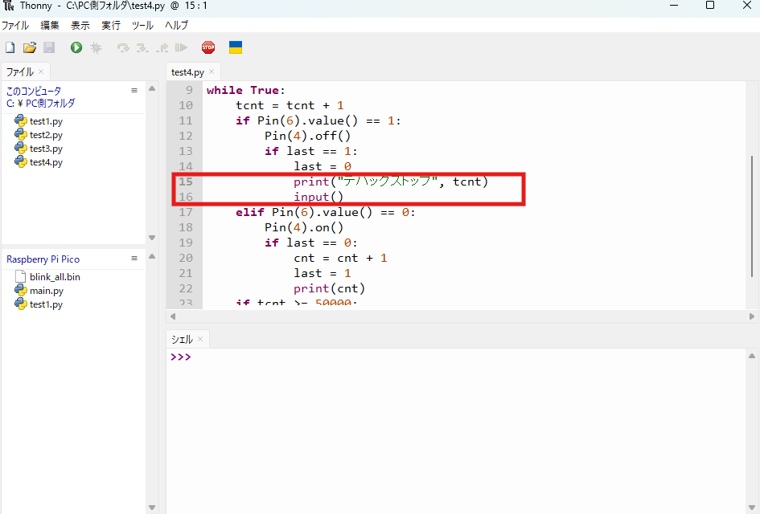
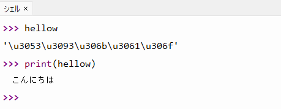
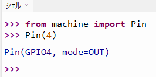

<!--
  手順書テンプレート(全ボード共通)
  - このファイルをコピーして、ボードごとのフォルダに保存してから書き始める。
  - 章の番号と名前は変えない。該当しない章は消さずに「本ボードでは作成しない(理由:〜)」と書く。
  - ボード独自の内容は、第9章以降に追加章として書く。
  - このコメントはプレビューには表示されない。消さずに残してよい。
-->

# 【ボード名】開発手順書

| 項目 | 内容 |
|---|---|
| 対象ボード | |
| 開発言語 | |
| IDE・ツール | (名称とバージョン) |
| SDK・ライブラリ | (名称とバージョン) |
| 開発PCのOS | (例:Windows 11 24H2) |
| 最終検証日 | (yyyy/mm/dd) |

## 改版履歴

| 版 | 日付 | 担当者 | 内容 |
|---|---|---|---|
| 0.1 | (yyyy/mm/dd) | | 新規作成 |

---

## 0. 概要

### 0.1 この手順書でできること
<!-- 読者がこの手順書を最後まで進めると何ができるようになるかを書く -->

### 0.2 必要な機材

| 品名 | 数量 | 備考 |
|---|---|---|
| | | |

### 0.3 前提知識・事前準備
<!-- 既存の Git/GitHub 運用・Redmine 運用を参考に、前提とする知識と準備を書く -->

---

## 1. 開発環境構築

### 1.1 ツールのインストール
### 1.2 ドライバのインストール
### 1.3 インストールできたことの確認

## 2. シリアルターミナルの使い方

### 2.1 使用するツールと接続方法
### 2.2 通信設定(ポート、ボーレートなど)
### 2.3 動作確認

## 3. プロジェクト作成

### 3.1 新規プロジェクトの作成
### 3.2 プロジェクトの構成(フォルダ・ファイルの役割)

## 4. コーディング・ビルド・書込み(RTOSなし)

<!-- 各題材の節は「作るもの → 配線 → プログラム → ビルドと書込み → 動作確認」の順で書く -->

### 4.1 題材1:LED点滅
### 4.2 題材2:ボタン入力
### 4.3 題材3:UART出力
### 4.4 題材4:タイマ割込み

## 5. コーディング・ビルド・書込み(FreeRTOS)
Shrike-liteはFreeRTOS(リアルタイムOS)が非搭載となるため本章についての記載は省略する。
### 5.1 FreeRTOSの導入・設定
### 5.2 題材5:複数タスク
### 5.3 題材6:タスク間通信

## 6. デバッグ
本章ではShrike-liteでのデバッグ手法について説明する。  
尚、Shrike-liteでは標準的なIDEに搭載されているブレークポイントやステップ実行といったコード上での確認は行うことは出来ない(但し、Shrike-liteの機能を用いないPython単体の実行確認は可能)。  
マイコン側とFPGA側ではデバッグ手法が異なるので分けて説明する。
### 6.1 デバッガの接続(配線図・写真)
Shrike-liteではICEなどのデバッグ用の機器は使用しない。それぞれ以下のツールを用いてデバッグを行う。  
#### マイコン側
Thonnyを用いたスクリプト実行や値確認を行う。
#### FPGA側
Go Configure Software Hubを用いてのテストベンチによるシミュレーションの実行結果を確認する。  
尚、Go Configure Software Hubのインストール手順や詳しい使用方法については9章以降に記載する。
### 6.2 デバッグの開始
#### マイコン側 Thonnyから実行
1. Thonnyを起動しShrike-liteとPCを接続する。
1. Shrike-liteまたはPC内のファイルから実行したいpythonスクリプトのファイルをダブルクリックしコードを表示する。  
  
1. 画面左上のツールバーから緑色の再生ボタン **現在のスクリプトを実行** または **F5キー** の押下でスクリプトが実行される。
   
  
1. 実行中のスクリプトを停止する場合は　**ctrl + cキー** の押下で停止する。  
停止した際にシェル画面には実行中だった行番号が表示される。  
  
    >注意：スクリプトを停止した後、現在の位置からの再実行を行うことは出来ない。  
    >注意：ツールバーの赤いSTOPボタン **バックエンドをストップ/リスタート** の押下で停止させると実行中の内部変数の状態も消去されるため停止は **ctrl + cキー** で行う。  
    
  
#### マイコン側 REPLから実行
実行したいスクリプトファイルがShrike-lite上にある場合はREPLからの命令でスクリプトを実行出来る。  
1. REPLから実行したいスクリプトを以下の様に入力すると実行される。(対象ファイルが”test1.py”の場合)  
    ```python
    import test1
    ```  
      
    >注意：ファイル拡張子(.py)は付けない。
1. 停止する場合は **ctrl + cキー** で行う。 

#### FPGA側 シミュレーション実行
1. Verilogコード(画像ではmain.v)とテストベンチコード(画像ではchip_tb.vt)を作成し、Go Configure Software HubのForgeFPGA WorkshopからツールバーのSimulation → **Run RTL Simulation** 押下する。  
  
1. テストベンチの選択画面が出るので実行したいテストベンチを選択し **Simulate** を押下する。  
  
1. Verilogやテストベンチのコードに異常がなければGTKWaveが起動する。SSTから出力させたい信号を選択すると波形が表示される。
 


### 6.3 ブレークポイント・ステップ実行
#### マイコン側
前述の通り、Shrike-liteではブレークポイントの貼り付けやステップ実行を行うことは出来ない。  
コードの特定の位置で停止し値の確認を行いたい場合はPythonのprint()/input()の関数を用いて疑似的に行う。
1. スクリプトのコードの中で停止したい箇所にprint()→input()の順に処理を追加する。print()の引数には表示したいコメントや変数を入れる。  
  
1. スクリプトを実行し処理を追加した箇所に来るとプログラムはprint()での表示を行いinput()の入力待ちの状態となる。処理を続行させる場合はシェル画面で **enterキー** を押下する。
 

#### FPGA側
FPGA側でもGo Configure Software Hubでブレークポイントの貼り付けやステップ実行を行うことはできない。
GTKWaveで出力される波形からコードの行単位ではなく時間経過で信号や値の変化を追っていく。

### 6.4 変数・メモリ・レジスタの確認
#### マイコン側
Pythonコード内で使用する変数やポートの確認方法について説明する。
- スクリプトの実行が終了した後（またはctrl + cキーで中断した後）、REPLから変数名を入力するとスクリプト終了時点での値が表示される。  
  
- 変数に文字列が入っている場合は文字コードの値が表示される。文字列を確認したい場合はprint()関数を用いる。
  
- Pinの入出力設定の確認は以下を入力する。（Pin4の場合）  
     ```python
    from machine import Pin
    Pin(4)
    ```    
     　
- PinのH/Lを確認は以下を入力する。
     ```python
    Pin(4).value()
    ``` 
     　


## 7. トラブルシューティング

| 症状 | 原因 | 対処 |
|---|---|---|
| | | |

## 8. 参考資料

- 

<!-- ボード独自の追加章がある場合は、ここから「## 9. 〜」として追加する -->

<!--
  記述ルール(書きぶりを全章でそろえる)
  1. 見出し:章は「## 1. 開発環境構築」、節は「### 1.1 ツールのインストール」の形にする。
  2. 手順:番号付きリストで書き、1つの番号に1つの操作。文末は「〜する。」にそろえる。
  3. 確認:手順のあとに「> 確認:〜れば成功」と、成功したかどうかの判断方法を書く。
  4. 注意:まちがえやすい所は「> 注意:〜」と書く。
  5. 画像:画面操作にはスクリーンショットを付ける。images/ に置き、名前は担当番号から始める(例:p1_ext.png)。
  6. 図:処理の流れやタスクの関係は Mermaid で書く。配線は図か写真で、ピン番号と信号名を書く。
  7. プログラム:手順書の中にコードブロックで書き、日本語のコメントを付ける。
  8. バージョン:ツールと SDK のバージョンを書く。
  9. 用語:同じものは同じことばで書く。英数字は半角で、日本語との間に半角スペースを入れる。
  10. つまずいた点:第7章に必ず記録する。
-->
