<!--
  手順書テンプレート(全ボード共通)
  - このファイルをコピーして、ボードごとのフォルダに保存してから書き始める。
  - 章の番号と名前は変えない。該当しない章は消さずに「本ボードでは作成しない(理由:〜)」と書く。
  - ボード独自の内容は、第9章以降に追加章として書く。
  - このコメントはプレビューには表示されない。消さずに残してよい。
-->

# 【ボード名】開発手順書

| 項目 | 内容 |
|---|---|
| 対象ボード | |
| 開発言語 | |
| IDE・ツール | (名称とバージョン) |
| SDK・ライブラリ | (名称とバージョン) |
| 開発PCのOS | (例:Windows 11 24H2) |
| 最終検証日 | (yyyy/mm/dd) |

## 改版履歴

| 版 | 日付 | 担当者 | 内容 |
|---|---|---|---|
| 0.1 | (yyyy/mm/dd) | | 新規作成 |

---

## 0. 概要

### 0.1 この手順書でできること
<!-- 読者がこの手順書を最後まで進めると何ができるようになるかを書く -->

### 0.2 必要な機材

| 品名 | 数量 | 備考 |
|---|---|---|
| | | |

### 0.3 前提知識・事前準備
<!-- 既存の Git/GitHub 運用・Redmine 運用を参考に、前提とする知識と準備を書く -->

---

## 1. 開発環境構築

### 1.1 ツールのインストール
### 1.2 ドライバのインストール
### 1.3 インストールできたことの確認

## 2. シリアルターミナルの使い方

### 2.1 使用するツールと接続方法
### 2.2 通信設定(ポート、ボーレートなど)
### 2.3 動作確認

## 3. プロジェクト作成

### 3.1 新規プロジェクトの作成
### 3.2 プロジェクトの構成(フォルダ・ファイルの役割)

## 4. コーディング・ビルド・書込み(RTOSなし)

<!-- 各題材の節は「作るもの → 配線 → プログラム → ビルドと書込み → 動作確認」の順で書く -->

### 4.1 題材1:LED点滅
### 4.2 題材2:ボタン入力
### 4.3 題材3:UART出力
### 4.4 題材4:タイマ割込み

## 5. コーディング・ビルド・書込み(FreeRTOS)
本ボードでは、標準の Shrike MicroPython 環境を使用するため、FreeRTOS を利用した開発は行わない。  
そのため、本章に記載する FreeRTOS の導入・設定および題材の実施は対象外とする。  
### 5.1 FreeRTOSの導入・設定  
本ボードでは、FreeRTOS を使用せず、MicroPython の実行環境を使用するため、本節では実施しない。  
### 5.2 題材5:複数タスク  
本ボードでは、FreeRTOS のタスク機能を使用したプログラム開発を行わないため、本節では実施しない。  
### 5.3 題材6:タスク間通信  
本ボードでは、FreeRTOS のタスク間通信機能を使用しないため、本節では実施しない。  

## 6. デバッグ
本章では Shrike-lite でのデバッグ手法について説明する。  
なお、Shrike-lite では標準的な IDE に搭載されているブレークポイントやステップ実行といったコード上での確認は行うことは出来ない(但し、 Shrike-lite の機能を用いない Python 単体の実行確認は可能)。  
マイコン側と FPGA 側ではデバッグ手法が異なるので分けて説明する。  
### 6.1 デバッガの接続(配線図・写真)
Shrike-lite では ICE などのデバッグ用の機器は使用しない。それぞれ以下のツールを用いてデバッグを行う。  
#### マイコン側
Thonny を用いたスクリプト実行や値確認を行う。
#### FPGA側
Go Configure Software Hub を用いてのテストベンチによるシミュレーションの実行結果を確認する。  
なお、Go Configure Software Hub のインストール手順や詳しい使用方法については9章以降に記載する。  
### 6.2 デバッグの開始
#### マイコン側 Thonnyから実行
1. Thonny を起動し Shrike-lite と PC を接続する。  
1. Shrike-lite または PC 内のファイルから実行したい Python スクリプトのファイルをダブルクリックしコードを表示する。  
  
1. 画面左上のツールバーから緑色の再生ボタン **現在のスクリプトを実行** または **F5キー** の押下でスクリプトが実行される。  
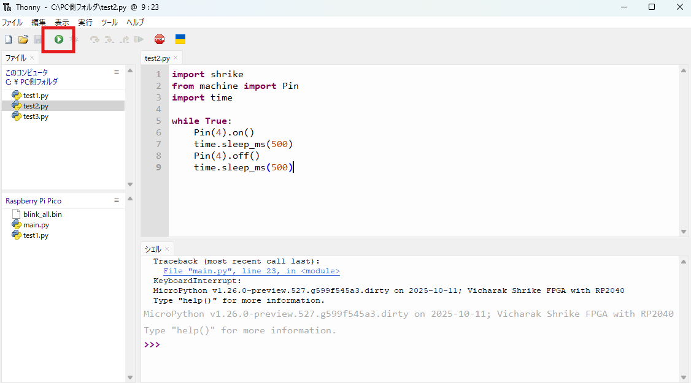   
1. 実行中のスクリプトを停止する場合は　**Ctrlキー + Cキー** を押下で停止する。  
停止した際にシェル画面には実行中だった行番号が表示される。  
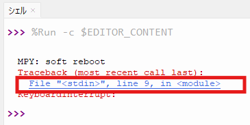  
    >注意1：Ctrl キー + C キーでスクリプトを中断した場合、停止した位置から処理を再開することはできない。再実行する場合は、スクリプトを最初から実行する。  
    >注意2：ツールバーの赤い STOP ボタン**バックエンドをストップ/リスタート**の押下で停止させると実行中の内部変数の状態も消去されるため停止は**Ctrl キー + C キー**を押下する。  
      

1. スクリプト実行の際にコードが正しくない場合はスクリプトは停止し異常が見つかった箇所の行番号が表示される。  
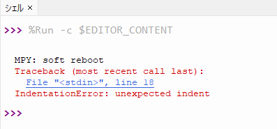  
>注意：エラーの行番号はあくまで目安の位置となる。異常個所を探す際には前後の行も含めて確認する。

#### マイコン側 REPLから実行
実行したいスクリプトファイルが Shrike-lite 上にある場合は REPL からの命令でスクリプトを実行出来る。  
1. REPL から実行したいスクリプトを以下の様に入力すると実行される。(対象ファイルが”test1.py”の場合)  
    ```python
    import test1
    ```  
    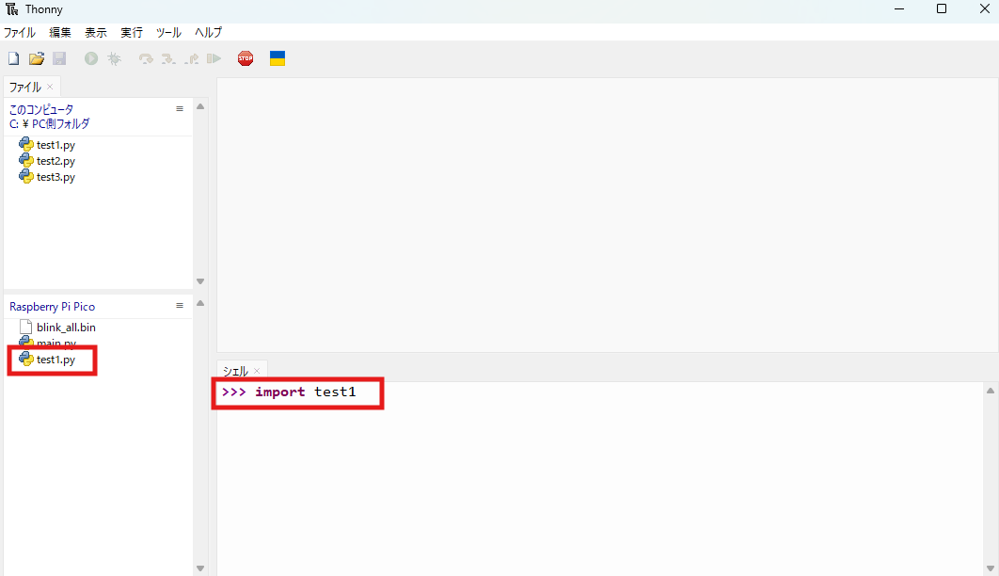  
    >注意：ファイル拡張子(.py)は付けない。
1. 停止する場合は **Ctrl キー + C キー**を押下する。  
#### FPGA側 シミュレーション実行
1. Verilog コード(画像では main.v )とテストベンチコード(画像では chip_tb.vt )を作成し、Go Configure Software Hub の ForgeFPGA Workshop からツールバーの Simulation → **Run RTL Simulation** 押下する。  
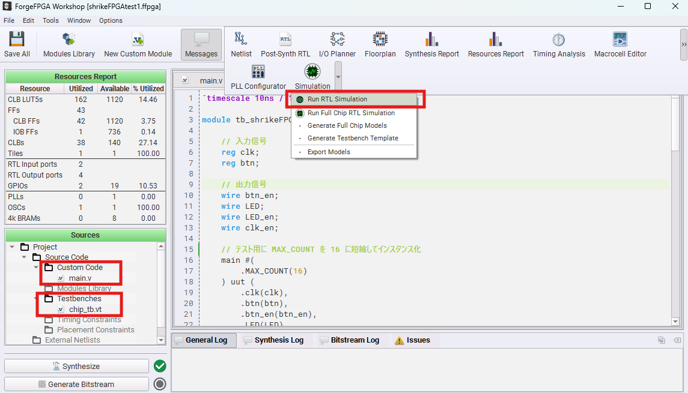  
1. テストベンチの選択画面が出るので実行したいテストベンチを選択し **Simulate** を押下する。  
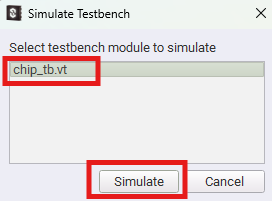  
1. Verilog やテストベンチのコードに異常がなければ GTKWave が起動する。 SST から出力させたい信号を選択すると波形が表示される。
  


### 6.3 ブレークポイント・ステップ実行
#### マイコン側
前述の通り、 Shrike-lite ではブレークポイントの貼り付けやステップ実行を行うことは出来ない。  
コードの特定の位置で停止し値の確認を行いたい場合は Python の print()/input() の関数を用いて疑似的に行う。  
1. スクリプトのコードの中で停止したい箇所に print() → input() の順に処理を追加する。 print() の引数には表示したいコメントや変数を入れる。  
  

1. スクリプトを実行し処理を追加した箇所に来るとプログラムはprint()での表示を行いinput()の入力待ちの状態となる。処理を続行させる場合はシェル画面で **Enterキー** を押下する。  
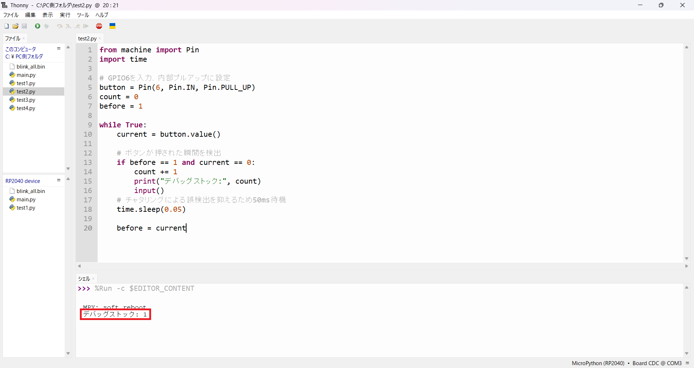  

#### FPGA側
FPGA 側でも Go Configure Software Hub でブレークポイントの貼り付けやステップ実行を行うことはできない。  
GTKWave で出力される波形からコードの行単位ではなく時間経過で信号や値の変化を追っていく。  

### 6.4 変数・メモリ・レジスタの確認
#### マイコン側
Python コード内で使用する変数やポートの確認方法について説明する。  
- スクリプトの実行が終了した後(または Ctrl キー + C キーを押下で中断した後)、 REPL から変数名を入力するとスクリプト終了時点での値が表示される。  
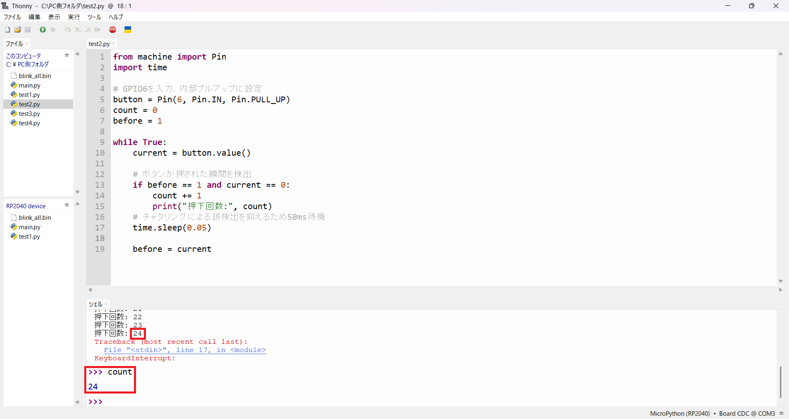  
- 変数に文字列が入っている場合は文字コードの値が表示される。文字列を確認したい場合は print() 関数を用いる。  
  
- Pin の入出力設定の確認は以下を入力する。( Pin4 の場合)  
     ```python
    from machine import Pin
    Pin(4)
    ```    
    出力の "mode=" に Pin が IN/OUT のどちらに使われているか表示される。  
     　
- Pin の H/L を確認は以下を入力する。  
     ```python
    Pin(4).value()
    ``` 
    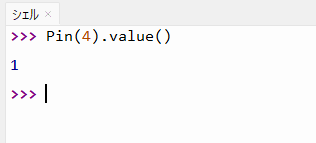 　
- Thonny の **現在のスクリプトを実行** から実行させた場合、Thonny 上から変数の値を確認できる。  
1. メニューバーから **表示** を選択する。  
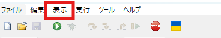 　
1. 一覧から **変数**にチェックを入れる。  
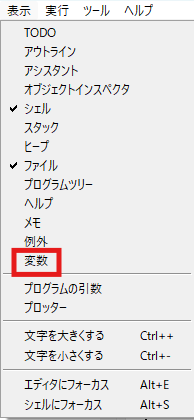  
1. 右側に現在使われている変数の一覧が表示される。  
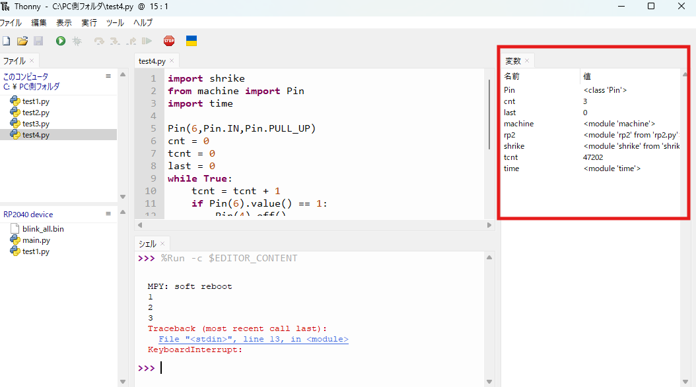  
#### FPGA側
FPGA 内で使用される変数や PIN の状態を調べる場合、シミュレーション実行結果の波形から指定した Maker (画像内のピンクの縦線)の位置での各状態を Signals から確認できる。  
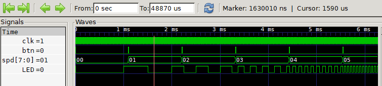  
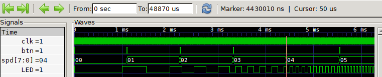  

## 7. トラブルシューティング

| 症状 | 原因 | 対処 |
|---|---|---|
| | | |

## 8. 参考資料
- 
- 

<!-- ボード独自の追加章がある場合は、ここから「## 9. 〜」として追加する -->

## 11. マイコンとFPGAの連携
Shrike-lite ではマイコン側の GPIO14,15 と FPGA 側の GPIO18,17 は信号線が直結している。  
それぞれの Pin に役割を持たせる事でマイコンと FPGA 間での連携した動作を行うことが出来る。  
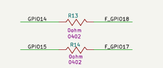   
本章では題材に沿ってマイコンと FPGA 間の連携について記載する。  

### 11.1 題材8:マイコンからFPGAを制御  
マイコン側のボタンを押す毎に FPGA 側の LED の点滅速度が変化するプログラムを作成する。  
なお、 Shrike-lite 基板上にある LED を使用するため、配線は不要とする。  
それぞれが行う動作と使用する Pin は以下となる。  

#### マイコン側
1. ボタンの入力状態を確認する  
1. チャタリング制御を行い入力状態を確定させる  
1. 確定した信号を FPGA 側に出力する  

使用Pin  
- GPIO6　 In　ボタン入力  
- GPIO15  Out FPGAへの出力信号  


#### FPGA側
1. 0.5 秒周期で LED を点滅させる  
1. マイコンからの入力信号の立ち上がり (0→1) を検知する  
1. 立ち上がりを検知するごとに速度の段階を1段ずつ上げていく(初期値 0 、 0~6 の 7 段階)  
1. 速度の段階が6を超えた場合は0に戻る  
1. 段階が上がる毎にLEDの点滅周期を1/2にする(点滅速度を速くする： 1 倍, 2 倍, 4 倍, 8 倍, 16 倍, 32 倍, 64 倍)  

使用Pin  
- GPIO17  IN  マイコンからの入力信号  
- GPIO6   Out LEDへの出力  

実施手順は以下となる。  
1. Shrike-lite を PC に USB 接続する。  
1. Thonny を起動する。  
1. 3.1 新規プロジェクトの作成を参照し、ファイル名を main.py として新規作成する。  
1. 一覧から main.py を探す。
1. 作成した main.py に、次に記載するプログラムを記述する。  
    ```python 
    import shrike
    from machine import Pin
    import time

    button = Pin(6,Pin.IN,Pin.PULL_UP) #　ボタン入力設定
    fpga = Pin(15,Pin.OUT) # FPGA側への信号

    last = 0
    logh = 0
    logl = 0

    while True:
        if button.value() == 1: # ボタン押されていない
            logl = 0
            if last == 1: # 現在押し確定
                logh = logh + 1
                if logh > 10: # 10回連続離されている
                    last = 0 # 離し確定
                    fpga.off() #FPGAへOFFを出力
                    time.sleep_ms(10)
                    
        else: # ボタン押されている
            logh = 0
            if last == 0: # 現在離し確定
                logl = logl + 1
                if logl > 10: # 10回連続押されている
                    last = 1 # 押し確定
                    fpga.on() #FPGAへONを出力
                    time.sleep_ms(10)
    ```  
1. 作成した main.py を Shrike-lite のボード上に保存する。 
   保存方法は[3.1 新規プロジェクトの作成](#31-新規プロジェクトの作成)を参照する。　　
1. 次に記載するプログラムを Verilog の main.v に記述する。  
    ```verilog
    (* top *) module main #(
        parameter MAX_COUNT = 50_000_000 //点滅速度基準値
      )(
        (* iopad_external_pin, clkbuf_inhibit *) input clk, //OSC_CLK
        (* iopad_external_pin *) input btn,                 //GPIO17_IN
        (* iopad_external_pin *) output btn_en,             //GPIO17_OE
        (* iopad_external_pin *) output LED,                //GPIO16_OUT
        (* iopad_external_pin *) output LED_en,             //GPIO16_OE
        (* iopad_external_pin *) output clk_en              //OCS_EN
        );

        reg [31:0] counter = 32'd0; //タイマ累積カウンタ
        reg LED_status = 1'b0;      //LEDの点灯状態
        reg lastbtn= 1'b0;          //マイコンからの前回の入力信号
        reg [7:0]spd = 8'd0;        //点滅速度 0~6段階

        assign LED_en = 1'b1;       //出力設定
        assign clk_en = 1'b1;       //クロック許可
        assign btn_en = 1'b0;       //入力設定
        
        always @ (posedge clk) begin
          if((btn == 1'b1)&&(lastbtn == 1'b0)) begin //入力信号立ち上がり
            spd = spd + 8'd1;       //速度UP
            if(spd > 8'd6) begin    //6段階目以上であれば0に戻す
              spd = 8'd0;
            end
            lastbtn = btn;          //前回の入力信号を更新
          end
          else if(btn == 1'b0) begin  //入力信号がOFF
            lastbtn = btn;          //前回の入力信号を更新
          end
          counter <= counter + 1'b1; //累積カウンタを更新

          if (counter > (50_000_000 >> spd)) begin //累積カウンタが点滅速度の基準値を超えている
            LED_status <= !LED_status;  //LED点灯状態を反転
            counter <= 32'b0;       //累積カウンタをクリア
          end
        end

        assign LED = LED_status;

      endmodule 
    ```  
1. I/O Planner には以下の様に設定する。  
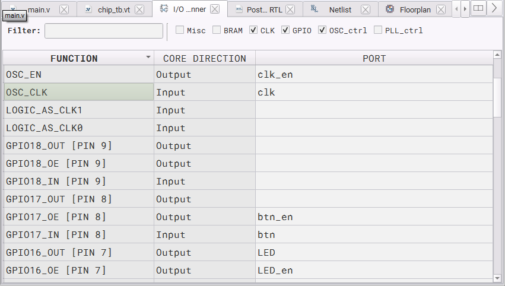   
1. 記述したコードでの bin ファイルを作成する。  
1. 作成した bin ファイルは Shrike-lite 上へ移動し、 REPL から[shrike.flash("***.bin")]で FPGA へ書き込む。  
1. マイコンのスクリプトを実行する。  
<!--
  記述ルール(書きぶりを全章でそろえる)
  1. 見出し:章は「## 1. 開発環境構築」、節は「### 1.1 ツールのインストール」の形にする。
  2. 手順:番号付きリストで書き、1つの番号に1つの操作。文末は「〜する。」にそろえる。
  3. 確認:手順のあとに「> 確認:〜れば成功」と、成功したかどうかの判断方法を書く。
  4. 注意:まちがえやすい所は「> 注意:〜」と書く。
  5. 画像:画面操作にはスクリーンショットを付ける。images/ に置き、名前は担当番号から始める(例:p1_ext.png)。
  6. 図:処理の流れやタスクの関係は Mermaid で書く。配線は図か写真で、ピン番号と信号名を書く。
  7. プログラム:手順書の中にコードブロックで書き、日本語のコメントを付ける。
  8. バージョン:ツールと SDK のバージョンを書く。
  9. 用語:同じものは同じことばで書く。英数字は半角で、日本語との間に半角スペースを入れる。
  10. つまずいた点:第7章に必ず記録する。
-->
