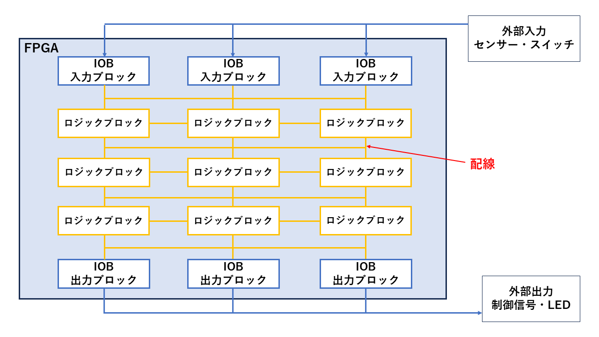
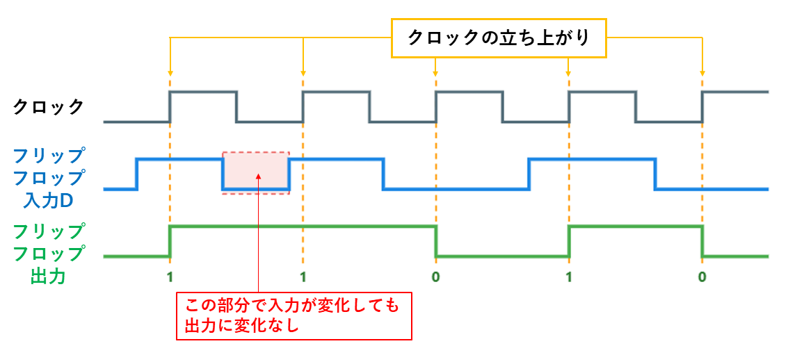

<!--
  手順書テンプレート(全ボード共通)
  - このファイルをコピーして、ボードごとのフォルダに保存してから書き始める。
  - 章の番号と名前は変えない。該当しない章は消さずに「本ボードでは作成しない(理由:〜)」と書く。
  - ボード独自の内容は、第9章以降に追加章として書く。
  - このコメントはプレビューには表示されない。消さずに残してよい。
-->

# 【ボード名】開発手順書

| 項目 | 内容 |
|---|---|
| 対象ボード | |
| 開発言語 | |
| IDE・ツール | (名称とバージョン) |
| SDK・ライブラリ | (名称とバージョン) |
| 開発PCのOS | (例:Windows 11 24H2) |
| 最終検証日 | (yyyy/mm/dd) |

## 改版履歴

| 版 | 日付 | 担当者 | 内容 |
|---|---|---|---|
| 0.1 | (yyyy/mm/dd) | | 新規作成 |

---

## 0. 概要

### 0.1 この手順書でできること
<!-- 読者がこの手順書を最後まで進めると何ができるようになるかを書く -->

### 0.2 必要な機材

| 品名 | 数量 | 備考 |
|---|---|---|
| | | |

### 0.3 前提知識・事前準備
<!-- 既存の Git/GitHub 運用・Redmine 運用を参考に、前提とする知識と準備を書く -->

---

## 1. 開発環境構築

### 1.1 ツールのインストール
### 1.2 ドライバのインストール
### 1.3 インストールできたことの確認

## 2. シリアルターミナルの使い方

### 2.1 使用するツールと接続方法
### 2.2 通信設定(ポート、ボーレートなど)
### 2.3 動作確認

## 3. プロジェクト作成

### 3.1 新規プロジェクトの作成
### 3.2 プロジェクトの構成(フォルダ・ファイルの役割)

## 4. コーディング・ビルド・書込み(RTOSなし)

<!-- 各題材の節は「作るもの → 配線 → プログラム → ビルドと書込み → 動作確認」の順で書く -->

### 4.1 題材1:LED点滅
### 4.2 題材2:ボタン入力
### 4.3 題材3:UART出力
### 4.4 題材4:タイマ割込み

## 5. コーディング・ビルド・書込み(FreeRTOS)

### 5.1 FreeRTOSの導入・設定
### 5.2 題材5:複数タスク
### 5.3 題材6:タスク間通信

## 6. デバッグ

### 6.1 デバッガの接続(配線図・写真)
### 6.2 デバッグの開始
### 6.3 ブレークポイント・ステップ実行
### 6.4 変数・メモリ・レジスタの確認

## 7. トラブルシューティング

| 症状 | 原因 | 対処 |
|---|---|---|
| | | |

## 8. 参考資料

- 

## 9. FPGAの開発環境とプロジェクト作成
　本章では Shrike-lite に内蔵されている FPGA に関する基礎知識や FPGA の開発環境の構築手順、Shrike-lite のピン割り当てについて説明する。

### 9.1 FPGAの基礎
- 概要 
　FPGA (Field Programmable Gate Array) はユーザーが目的に応じて内部の論理回路を自由に設計・変更できる半導体デバイスである。一般的なCPUやマイコンは製造時点で内部の回路構成や機能が決まっている。しかし FPGA はユーザーが設計した論理回路を書きこむことで、用途に合わせた専用のハードウェアを構成できる。
  
- 特徴
  - 用途に合わせて論理回路を構成できる
  - 並列処理能力に長けており複数の回路を同時に動作させられる
  - 回路構成を編集することで機能を変更できる
  - Verilog や VHDL などのハードウェア記述言語を用いて開発する
  
- 内部構造 
　FPGA の内部には多数の「ロジックブロック」という小さなブロックや配線が並んでいる。下図は FPGA の基本的な内部構造を簡略化したものであり、センサーやスイッチなどの外部入力を受けてから制御信号や LED として外部出力するまでの流れを付け加えている。  
  
  - ロジックブロック 
  FPGA内部で回路を構成するための基本単位。ロジックブロックの内部には LUT やフリップフロップが含まれており、これらを組み合わせることで多様な論理回路を実現できる。
  - 配線 
  ロジックブロックやその他の回路を接続して必要な信号をやり取りできるようにする。FPGA 内部の配線を変更することで、目的に応じた回路を構成できる。
  - 入出力ブロック（I/O Block） 
  外部のセンサーや LED などと信号をやり取りする窓口。
  
- LUT（ルックアップテーブル） 
　**入力された信号の組み合わせに応じて、予め設定された1ビットの値を出力する「真理値表」のような小さな回路。** 
　例えば２つの入力信号 A,B がある場合、それぞれの値が0か1かで4通りの組み合わせ（00, 01, 10, 11）になる。LUT は計4通りの入力の組み合わせに対してそれぞれの出力を設定することができる。その真理値表が下記の表だった場合、LUT は「A と B の値が異なる時に出力する値が1になる」排他的論理和（XOR）を出力する関数を実現する。
 
  | 入力A | 入力B | 出力 |
  |---|---|---|
  | 0 | 0 | 0 |
  | 0 | 1 | 1 |
  | 1 | 0 | 1 |
  | 1 | 1 | 0 |
 　　　このような組み合わせを予め設定することで、LUT は FPGA の柔軟かつ高速な並列処理を支えている。
 
- フリップフロップ 
　1ビットのデジタル信号を記憶できる回路。これにより、回路の中で「状態」の保存が可能になり、一定周期で送られる信号（クロック信号）に同期してデータを保持したり更新することができる。 
　Shrike-lite の FPGA には1120個の D フリップフロップが搭載されている。 
  - D フリップフロップ 
  1つの入力信号「D」を持つ。クロック信号が0から1に変化したタイミングで「D」を出力に反映する。 
    - D = 1：クロックの立ち上がり（または立ち下がり）で出力が「1」になる 
    - D = 0：クロックの立ち上がり（または立ち下がり）で出力が「0」になる 
   
  Dフリップフロップのタイミングチャートの例を以下に記載する。 
  
    
- クロック（クロック信号） 
　**回路全体のタイミングを揃えるための周期的な信号。** 一般的には「0」と「1」を繰り返す矩形波として表現される。 
　Shrike-lite の FPGA(SLG47910) には 50MHz の発振器が内蔵されている。先述のタイミングチャートでは、フリップフロップはクロックの立ち上がりでのみ動作し、クロックが立ち下がる間は入力値が変わっても出力値は変わらない。そのため 50MHz のクロックにより、FPGA 内の回路を一定のタイミングで動作させることができる。
　

### 9.2 Shrike-liteのピン割り当て

### 9.3 Go Configure Software Hubの入手とインストール
　Go Configure Software Hub は FPGA に搭載する回路データを開発・構成・シミュレーションするための GUI 開発環境である。

### 9.4 SLG47910のプロジェクトの作り方

## 10. FPGAの設計とシミュレーション

<!-- ボード独自の追加章がある場合は、ここから「## 9. 〜」として追加する -->

<!--
  記述ルール(書きぶりを全章でそろえる)
  1. 見出し:章は「## 1. 開発環境構築」、節は「### 1.1 ツールのインストール」の形にする。
  2. 手順:番号付きリストで書き、1つの番号に1つの操作。文末は「〜する。」にそろえる。
  3. 確認:手順のあとに「> 確認:〜れば成功」と、成功したかどうかの判断方法を書く。
  4. 注意:まちがえやすい所は「> 注意:〜」と書く。
  5. 画像:画面操作にはスクリーンショットを付ける。images/ に置き、名前は担当番号から始める(例:p1_ext.png)。
  6. 図:処理の流れやタスクの関係は Mermaid で書く。配線は図か写真で、ピン番号と信号名を書く。
  7. プログラム:手順書の中にコードブロックで書き、日本語のコメントを付ける。
  8. バージョン:ツールと SDK のバージョンを書く。
  9. 用語:同じものは同じことばで書く。英数字は半角で、日本語との間に半角スペースを入れる。
  10. つまずいた点:第7章に必ず記録する。
-->
