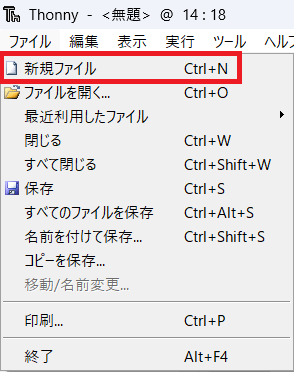
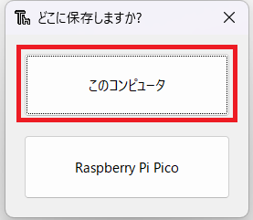
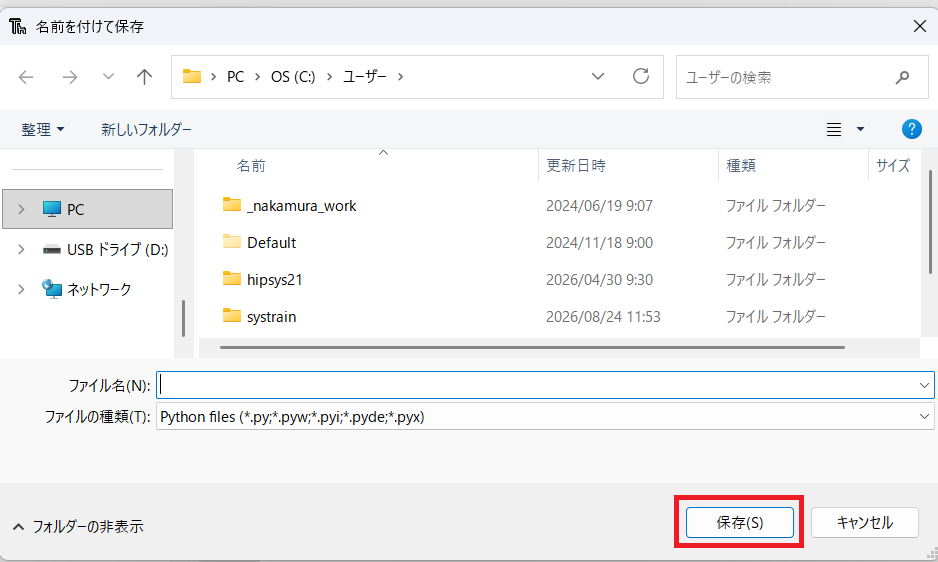
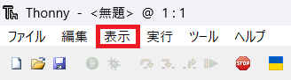
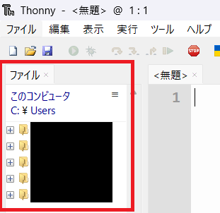
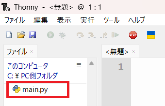
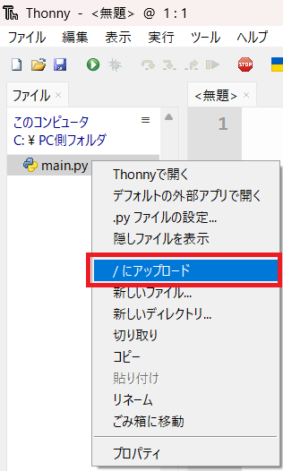
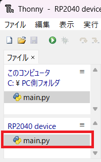

<!--
  手順書テンプレート(全ボード共通)
  - このファイルをコピーして、ボードごとのフォルダに保存してから書き始める。
  - 章の番号と名前は変えない。該当しない章は消さずに「本ボードでは作成しない(理由:〜)」と書く。
  - ボード独自の内容は、第9章以降に追加章として書く。
  - このコメントはプレビューには表示されない。消さずに残してよい。
-->

# 【ボード名】開発手順書

| 項目 | 内容 |
|---|---|
| 対象ボード | |
| 開発言語 | |
| IDE・ツール | (名称とバージョン) |
| SDK・ライブラリ | (名称とバージョン) |
| 開発PCのOS | (例:Windows 11 24H2) |
| 最終検証日 | (yyyy/mm/dd) |

## 改版履歴

| 版 | 日付 | 担当者 | 内容 |
|---|---|---|---|
| 0.1 | (yyyy/mm/dd) | | 新規作成 |

---

## 0. 概要

### 0.1 この手順書でできること
<!-- 読者がこの手順書を最後まで進めると何ができるようになるかを書く -->

### 0.2 必要な機材

| 品名 | 数量 | 備考 |
|---|---|---|
| | | |

### 0.3 前提知識・事前準備
<!-- 既存の Git/GitHub 運用・Redmine 運用を参考に、前提とする知識と準備を書く -->

---

## 1. 開発環境構築

### 1.1 ツールのインストール
### 1.2 ドライバのインストール
### 1.3 インストールできたことの確認

## 2. シリアルターミナルの使い方

### 2.1 使用するツールと接続方法
### 2.2 通信設定(ポート、ボーレートなど)
### 2.3 動作確認

## 3. プロジェクト作成
本章では、 Thonny を使用して Shrike-lite 向けの Python プログラムを作成し、 PC 上に保存したプログラムをボードへ転送して実行するまでの手順について説明する。また、ボード起動時にプログラムを自動実行するためのファイル構成についても説明する。  
### 3.1 新規プロジェクトの作成
本節では、 Thonny を使用して Shrike-lite で実行する Python プログラムを作成し、 PC 上に保存した後、ボードへ転送する手順について説明する。  
1.  Thonny を起動する。  
1. 上部のタブから**ファイル**をクリックする。  
  
1. **新規ファイル**をクリックして新しいファイルを作成する。  
  
1. 上部のタブから**ファイル**をクリックする。  
  
1. **名前を付けて保存**をクリックする。  
  
    >注意：マイコンをつないだままだと「どこに保存しますか？」が表示されるため、**このコンピュータ**を選択する。  
  
1. 任意の保存場所を指定する。  
  
1. 任意のファイル名を入力する。  
  
1. 保存をクリックする。  
  
1. 上部のタブから表示をクリックする。  
  
1. 開かれた項目からファイルをクリックする  
  
    >確認：Thonny の左側に「ファイル」パネルが表示されていれば成功。  
      
1. 接続先のポートが Shrike-lite に対応する COM ポートになっていることを確認する。  
   接続方法は[2.1 使用するツールと接続方法](#21-使用するツールと接続方法)を参照  
1. PC 側のファイル一覧から、ボードに保存する Python ファイルを右クリックする。  
  
1. 「/にアップロード」をクリックする。  
  
    >確認：Thonny 左側のボード側ファイル一覧に、アップロードしたファイル名が表示されていれば成功。  
    >注意：ファイルをアップロードする際は必ずマイコン上のプログラムが止まっていることを確認すること。  
アップロード前  
  
アップロード後  
  

### 3.2 プロジェクトの構成(フォルダ・ファイルの役割)
本節では、Python プロジェクトを構成するフォルダやファイルの役割について説明する。  
プログラムを機能ごとにファイルへ分割することで、処理の見通しをよくし、管理しやすい構成にすることができる。  
各ファイルの役割を次に示す。  
| ファイル | 役割 |
| ------- | ---- |
| boot.py | ボード起動時に実行する初期設定や初期化処理（ GPIO や通信機能の設定など）を記述するファイル。 |
| main.py | boot.py の実行後に自動実行されるメイン処理を記述するファイル。 |
| その他の.pyファイル | 機能ごとに分割した処理を記述するファイル。他の Python ファイルから読み込んで使用する。 |

## 4. コーディング・ビルド・書込み(RTOSなし)

<!-- 各題材の節は「作るもの → 配線 → プログラム → ビルドと書込み → 動作確認」の順で書く -->

### 4.1 題材1:LED点滅
### 4.2 題材2:ボタン入力
### 4.3 題材3:UART出力
### 4.4 題材4:タイマ割込み

## 5. コーディング・ビルド・書込み(FreeRTOS)

### 5.1 FreeRTOSの導入・設定
### 5.2 題材5:複数タスク
### 5.3 題材6:タスク間通信

## 6. デバッグ

### 6.1 デバッガの接続(配線図・写真)
### 6.2 デバッグの開始
### 6.3 ブレークポイント・ステップ実行
### 6.4 変数・メモリ・レジスタの確認

## 7. トラブルシューティング

| 症状 | 原因 | 対処 |
|---|---|---|
| | | |

## 8. 参考資料

- 

<!-- ボード独自の追加章がある場合は、ここから「## 9. 〜」として追加する -->

<!--
  記述ルール(書きぶりを全章でそろえる)
  1. 見出し:章は「## 1. 開発環境構築」、節は「### 1.1 ツールのインストール」の形にする。
  2. 手順:番号付きリストで書き、1つの番号に1つの操作。文末は「〜する。」にそろえる。
  3. 確認:手順のあとに「> 確認:〜れば成功」と、成功したかどうかの判断方法を書く。
  4. 注意:まちがえやすい所は「> 注意:〜」と書く。
  5. 画像:画面操作にはスクリーンショットを付ける。images/ に置き、名前は担当番号から始める(例:p1_ext.png)。
  6. 図:処理の流れやタスクの関係は Mermaid で書く。配線は図か写真で、ピン番号と信号名を書く。
  7. プログラム:手順書の中にコードブロックで書き、日本語のコメントを付ける。
  8. バージョン:ツールと SDK のバージョンを書く。
  9. 用語:同じものは同じことばで書く。英数字は半角で、日本語との間に半角スペースを入れる。
  10. つまずいた点:第7章に必ず記録する。
-->
